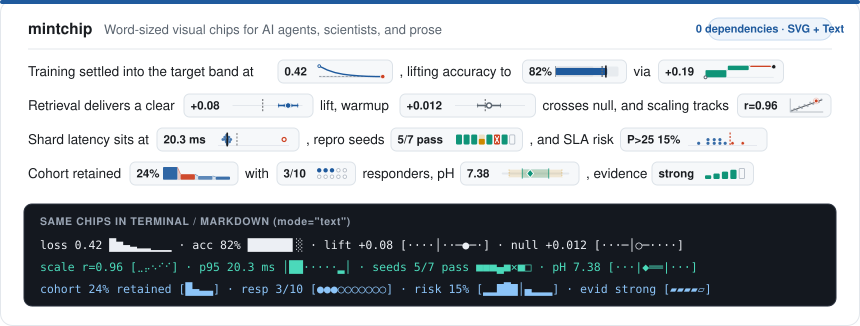
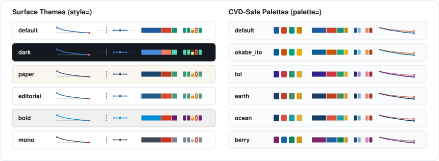

# mintchip

**Zero-dependency word-sized visual chips for AI agents, scientists, and prose.**

People are tired of watching plain text scroll by in agent interfaces. Full multi-panel charts aren't always needed — often you just want a **word-sized micro-graphic** sitting directly inside a sentence or table, carrying real data, uncertainty, and shape without needing a full TUI or Matplotlib stack.

`mintchip` turns quantitative results into **17 dual-surface inline chips** — pure Python standard library (`0` runtime dependencies, `< 15 ms` import), rendering every chip across four surfaces:

1. **Inline SVG (`.svg`)** — crisp, baseline-aligned, CVD-safe micro-visuals with accessible `<title>` tooltips on every mark.
2. **Unicode & ASCII text (`str(chip)`, `.to_text()`)** — single-line glyphs (sparklines, solid/hollow null-aware CIs, 10×4 Braille 2D scatters, countable icon arrays) that work in terminals, Markdown, Slack, and GitHub PRs.
3. **Interactive HTML Evidence Chips (`.html()`, `._repr_html_()`)** — clickable pills that unfold computed `facts` and, optionally, full multi-panel [`mintfig`](https://github.com/blaiszik/mintfig) figures (`expand=True`).
4. **Markdown embeds (`.markdown()`)** — inline code glyphs or base64 SVG data URIs.

[Quickstart](#quickstart) · [All 17 Chips at a Glance](#all-17-chips-at-a-glance) · [Prose Composition](#prose-composition) · **[Full Visual Gallery](gallery/README.md)** · [Themes & Palettes](#themes--palettes) · [mintfig Bridge](#optional-mintfig-bridge)

---



---

## Quickstart

```bash
pip install mintchip
# or with uv
uv add mintchip
# optional: auto-expand chips into full mintfig figures
pip install "mintchip[mintfig]"
```

```python
import mintchip as mc

# Lock sibling intervals onto one honest shared scale
dom = mc.shared_domain((0.05, 0.11), (-0.024, 0.048), reference=0.0)

loss = mc.spark([1.84, 1.32, 0.96, 0.74, 0.61, 0.52, 0.46, 0.43, 0.42], band=(0.38, 0.48))
lift = mc.ci(0.08, (0.05, 0.11), inner_error=(0.07, 0.09), error_label="95% CI, 5 seeds", domain=dom)
null = mc.ci(0.012, (-0.024, 0.048), error_label="95% CI, 5 seeds", domain=dom)
lat  = mc.dist([18.2, 19.1, 19.4, 19.8, 20.0, 20.3, 20.6, 21.1, 21.4, 22.0, 47.8], unit="ms", reference=25.0)

# Works in terminals & Markdown (mode="text") or interactive HTML (mode="html")
prose = (
    "Loss settled inside the target band at {loss}. Retrieval drives a clear {lift} gain, "
    "whereas warmup {null} still crosses zero; shard p95 latency sits at {lat}."
)
print(mc.format_prose(prose, mode="text", compact=True, loss=loss, lift=lift, null=null, lat=lat))
```

Output (`mode="text"`, zero external dependencies):

```text
Loss settled inside the target band at 0.42 █▆▄▃▂▂▁▁▁. Retrieval drives a clear +0.08 [··│··──●──·] gain, whereas warmup +0.012 [·─│○──·····] still crosses zero; shard p95 latency sits at 20.3 ms │██·····▂│.
```

Try the built-in CLI immediately:

```bash
mintchip catalog                # Preview all 17 chips in your terminal
mintchip demo                   # Print a full prose showcase
mintchip demo --html note.html  # Write a self-contained interactive HTML note
```

---

## All 17 Chips at a Glance

Every chip enforces visual-science hygiene (zero baselines on bars, named uncertainty, redundant shape + color cues, shared scales via `mc.shared_domain`, and computed `facts`). **[Browse the full Visual Gallery →](gallery/README.md)** or open **[gallery/output/index.html](gallery/output/index.html)** interactively in a browser.

### Core Primitives

| Chip | Question it answers | SVG Chip | Unicode (`mode="text"`) |
| :--- | :--- | :---: | :--- |
| **`mc.spark`** | How did a value evolve over steps or time? |  | `0.42 █▆▄▃▂▂▁▁▁` |
| **`mc.ci`** | What is the estimate & uncertainty vs. null? |  | `+0.08 [+0.05, +0.11] [··│··──●──·]` |
| **`mc.dist`** | How are raw observations spread (skew & outliers)? |  | `med 20.3 ms (IQR 1.65) │██·····▂│` |
| **`mc.bar`** | How large is a score vs. baseline & target? |  | `82% ██████▌░` |
| **`mc.strip`** | Which checks passed, warned, failed, or shifted? |  | `5/7 pass ■■■▄■×■□` |

### Change, Attribution & Tradeoffs

| Chip | Question it answers | SVG Chip | Unicode (`mode="text"`) |
| :--- | :--- | :---: | :--- |
| **`mc.delta`** | How far and in what direction did a value move? |  | `0.74→0.82 (+0.08) [····○─▶●···]` |
| **`mc.waterfall`** | Which drivers and drags summed to the net change? |  | `0.63→0.82 (+0.19) [▲█▲▅▼▂]` |
| **`mc.scatter`** | How do two measures correlate or sit on a Pareto front? |  | `r=0.96 [⣀⡤⠢⠊⠊]` |

### Composition, Funnels & Natural Frequencies

| Chip | Question it answers | SVG Chip | Unicode (`mode="text"`) |
| :--- | :--- | :---: | :--- |
| **`mc.share`** | How is a whole divided across categories (never a pie)? |  | `62/28/10% [██████▓▓▓░]` |
| **`mc.funnel`** | Where did items drop off across sequential stages? |  | `1,200→290 (24%) [█▄▃▃]` |
| **`mc.ratio`** | What does a probability feel like in natural frequencies? |  | `3/10 (30%) [●●●○○○○○○○]` |

### Operating Windows, Quantiles & Evidence

| Chip | Question it answers | SVG Chip | Unicode (`mode="text"`) |
| :--- | :--- | :---: | :--- |
| **`mc.gauge`** | Where does a reading sit inside normal & caution limits? |  | `7.38 [7.35–7.45] [···\|◆══\|···]` |
| **`mc.quantiles`** | What is the predictive probability mass past a threshold? |  | `P>25 ms 15% [▂▂▇█▇│▄▂▂▂]` |
| **`mc.evidence`** | How strong is the statistical evidence given effect & *n*? |  | `strong (p=0.002, n=48) [▰▰▰▰▱]` |

### Structure, Timelines & Comparisons

| Chip | Question it answers | SVG Chip | Unicode (`mode="text"`) |
| :--- | :--- | :---: | :--- |
| **`mc.timeline`** | Where did wall-clock time go & what was the bottleneck? |  | `7.5 s (solve 64%) [▓▓██████▒▒]` |
| **`mc.rank`** | Where does this entity sit in its cohort or leaderboard? |  | `#2/18 (p94) [········●·]` |
| **`mc.dual_spark`** | How did two paired trajectories diverge or cross? |  | `0.42 vs 0.61 (Δ−0.19) [▂▃▄▅▇▇█]` |

---

## Themes & Palettes

Every built-in surface theme (`style=`) and palette (`palette=`) uses the same CVD-safe, grayscale-separated, WCAG-checked hex tokens as `mintfig` — computed with zero dependencies and automatic dark-ground contrast lifting.



- **6 surface themes (`style=`):** `default` (aliases: `mintchip`, `mintfig`, `light`), `dark`, `paper`, `editorial`, `bold`, and `mono`.
- **6 palettes (`palette=`):** `default`, `okabe_ito`, `tol`, `earth`, `ocean`, and `berry` — plus custom `accent="#2563EB"`.

---

## Design Principles

| Principle | How `mintchip` enforces it |
| :--- | :--- |
| **Word-sized graphics** (Tufte 2006) | Every SVG is 13–16 px tall, baseline-aligned (`vertical-align: -0.18em`), and sits cleanly inside flowing text. |
| **Honest shared scales** (Cleveland & McGill 1984) | `mc.shared_domain(...)` locks sibling `ci`, `dist`, and `delta` chips onto one common axis so comparisons never lie. |
| **Redundant shape + color** (CVD & grayscale safety) | `ci` draws solid `●` when excluding null vs. hollow `○` when crossing null; `strip` uses solid, half-bar, cross, and outline; `dist` rings 1.5×IQR outliers. |
| **Countable probability** (Gigerenzer; Kay & Hullman 2016) | `mc.ratio` renders 2×5/2×10 natural-frequency icon arrays; `mc.quantiles` renders 10/20-dot quantile dotplots with threshold exceedance. |
| **Epistemic transparency** | Every chip computes structured `chip.facts` and flags unnamed uncertainty intervals or small-*n* (<10) evidence caveats in `chip.warnings`. |

---

## Optional `mintfig` Bridge

`mintchip` has **zero runtime dependencies**. When [`mintfig`](https://github.com/blaiszik/mintfig) is installed (`pip install "mintchip[mintfig]"`), pass `expand=True` (or an existing `mint.explain(...)` figure) to turn any word-sized chip into a clickable **evidence chip** (`↗`) that unfolds into a full publication-grade multi-panel chart inside HTML briefings or Jupyter notebooks:

```python
import mintchip as mc

chip = mc.ci(0.08, (0.05, 0.11), error_label="95% CI, 5 seeds", expand=True)
html_note = mc.document("Ablation Brief", [mc.format_prose("Retrieval lifted score by {c}.", c=chip)])
```

---

## Development

```bash
uv sync --extra dev
.venv/bin/pytest -q
.venv/bin/ruff check src tests
.venv/bin/python gallery/build_gallery.py
```
