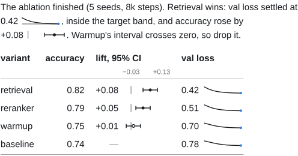

# mintchip

Word-sized graphics for the numbers in an agent's report. A trend, an interval, a before and
after or a pass/fail run sits inside the sentence or table cell that mentions it, as plain text,
Markdown or HTML, from one shell command. Python standard library only.

<!-- BEGIN mintchip:hero -->
**Before**: the report as an agent usually writes it.

```text
The ablation finished (5 seeds, 8k steps each). Retrieval did best: validation
loss went from 1.84 to 1.32, 0.96, 0.74, 0.61, 0.52, 0.46, 0.43 and finally
0.42, which is inside the 0.38–0.48 target band, and accuracy reached 0.82, a
lift of +0.08 over the baseline (95% CI +0.05 to +0.11). The reranker reached
0.79 accuracy (+0.05, 95% CI +0.02 to +0.08) with a final validation loss of
0.51. Warmup reached 0.75 (+0.01, 95% CI −0.02 to +0.04), so its effect is not
distinguishable from zero; its validation loss ended at 0.70. The baseline
reached 0.74 accuracy and a final validation loss of 0.78.
```

**After**: the same report with two chips and one table, rendered as HTML (`--format html`) in your
light or dark theme,



and as it prints in a terminal:

```text
The ablation finished (5 seeds, 8k steps). Retrieval wins: val loss settled at
0.42 (range 0.42 to 1.84) █▆▄▃▂▂▁▁▁, inside the target band, and accuracy rose
by +0.08 (95% CI +0.05 to +0.11) [·│···├─●─┤·]. Warmup's interval crosses zero,
so drop it.

variant    accuracy  lift, 95% CI         val loss
                           −0.03   +0.13
────────────────────────────────────────────────────────
retrieval      0.82  +0.08 [··│··├─●─┤·]  0.42 █▅▄▃▂▁▁▁▁
reranker       0.79  +0.05 [··│├─●─┤···]  0.51 █▆▄▃▂▂▂▁▁
warmup         0.75  +0.01 [·├┼○┤······]  0.70 █▆▅▄▃▃▃▂▂
baseline       0.74   —                   0.78 █▇▆▅▄▃▃▃▃
```

<details><summary>The two commands that wrote it</summary>

```text
$ cat message.txt
The ablation finished (5 seeds, 8k steps). Retrieval wins: val loss settled at {{spark 1.84 1.32 0.96 0.74 0.61 0.52 0.46 0.43 0.42 band=0.38:0.48}}, inside the target band, and accuracy rose by {{ci 0.08 0.05:0.11 level=0.95}}. Warmup's interval crosses zero, so drop it.
$ mintchip render message.txt
The ablation finished (5 seeds, 8k steps). Retrieval wins: val loss settled at 0.42 (range 0.42 to 1.84) █▆▄▃▂▂▁▁▁, inside the target band, and accuracy rose by +0.08 (95% CI +0.05 to +0.11) [·│···├─●─┤·]. Warmup's interval crosses zero, so drop it.

$ cat runs.json
[
{"variant": "retrieval", "acc": 0.82, "lift": [0.08, 0.05, 0.11], "loss": [1.84, 1.32, 0.96, 0.74, 0.61, 0.52, 0.46, 0.43, 0.42]},
{"variant": "reranker", "acc": 0.79, "lift": [0.05, 0.02, 0.08], "loss": [1.86, 1.41, 1.05, 0.83, 0.69, 0.6, 0.55, 0.52, 0.51]},
{"variant": "warmup", "acc": 0.75, "lift": [0.01, -0.02, 0.04], "loss": [1.8, 1.52, 1.25, 1.04, 0.9, 0.81, 0.75, 0.72, 0.7]},
{"variant": "baseline", "acc": 0.74, "lift": null, "loss": [1.85, 1.6, 1.36, 1.15, 0.99, 0.89, 0.83, 0.8, 0.78]}
]
$ mintchip table runs.json --col variant --col acc:num:accuracy --col 'lift:ci:lift, 95% CI' \
    --col 'loss:spark:val loss' --set lift.level=0.95
variant    accuracy  lift, 95% CI         val loss
                           −0.03   +0.13
────────────────────────────────────────────────────────
retrieval      0.82  +0.08 [··│··├─●─┤·]  0.42 █▅▄▃▂▁▁▁▁
reranker       0.79  +0.05 [··│├─●─┤···]  0.51 █▆▄▃▂▂▂▁▁
warmup         0.75  +0.01 [·├┼○┤······]  0.70 █▆▅▄▃▃▃▂▂
baseline       0.74   —                   0.78 █▇▆▅▄▃▃▃▃
```

</details>
<!-- END mintchip:hero -->

## Install

```bash
pip install git+https://github.com/blaiszik/mintchip   # or: uv tool install git+https://github.com/blaiszik/mintchip
```

Python 3.10 or later, no dependencies. It installs one command, `mintchip`.

## Three commands

<!-- BEGIN mintchip:commands -->
**One chip.** Values fill the chip's slots in order; options are `--name value`.

```text
$ mintchip spark 1.84 1.32 0.96 0.74 0.61 0.52 0.46 0.43 0.42 --band 0.38:0.48
0.42 (range 0.42 to 1.84) █▆▄▃▂▂▁▁▁
```

**A message.** `render` replaces each `{{kind …}}` directive in the prose with its chip. The tokens
are the ones the command line takes, with options as `name=value`.

```text
$ mintchip render - <<'EOF'
Val loss settled at {{spark 1.84 1.32 0.96 0.74 0.61 0.52 0.46 0.43 0.42 band=0.38:0.48}}, and retrieval lifted accuracy by {{ci 0.08 0.05:0.11 level=0.95}}.
EOF
Val loss settled at 0.42 (range 0.42 to 1.84) █▆▄▃▂▂▁▁▁, and retrieval lifted accuracy by +0.08 (95% CI +0.05 to +0.11) [·│···├─●─┤·].
```

**A table.** Three or more comparable things go in a table, and each chip column shares one scale:
the `ci` column below is a forest plot with one zero line.

```text
$ mintchip table - --col variant --col acc:num:accuracy --col 'lift:ci:lift, 95% CI' \
    --set lift.level=0.95 <<'EOF'
[
{"variant": "retrieval", "acc": 0.82, "lift": [0.08, 0.05, 0.11]},
{"variant": "reranker", "acc": 0.79, "lift": [0.05, 0.02, 0.08]},
{"variant": "warmup", "acc": 0.75, "lift": [0.01, -0.02, 0.04]},
{"variant": "baseline", "acc": 0.74, "lift": null}
]
EOF
variant    accuracy  lift, 95% CI
                           −0.03   +0.13
────────────────────────────────────────
retrieval      0.82  +0.08 [··│··├─●─┤·]
reranker       0.79  +0.05 [··│├─●─┤···]
warmup         0.75  +0.01 [·├┼○┤······]
baseline       0.74   —
```

Every command takes `--format text|md|ansi|html|svg|json`, `--ascii` and `--compact`. stdout carries
only the result. A distortion, such as a clipped outlier or a cut axis, is marked in the chip and
named in a warning on stderr; `--strict` makes that exit 1.
<!-- END mintchip:commands -->

## Pick a chip by what you have

Each image below is the chip at its real size; it takes the colour of the text around it, so it
reads in light and dark themes. The [gallery](gallery/README.md) shows every chip in a sentence,
in a table beside its siblings, and at its edge cases, with the warning each one prints.

<!-- BEGIN mintchip:catalog -->
| You have | Chip | At 1× | As text |
|---|---|---|---|
| One number, no context | [`num`](gallery/README.md#num) | — | `0.82 ± 0.03` |
| A series over time or steps | [`spark`](gallery/README.md#spark) |  | `0.42 █▆▄▃▂▂▁▁▁` |
| An estimate with an interval | [`ci`](gallery/README.md#ci) |  | `+0.08 [·│···├─●─┤·]` |
| Raw samples of one measurement | [`dist`](gallery/README.md#dist) |  | `med 20.3 ms [▃▃▃█·▃▃··▃]→47.8` |
| A value against a total | [`bar`](gallery/README.md#bar) |  | `82% ██████▌│` |
| A reading with a normal range | [`gauge`](gallery/README.md#gauge) |  | `7.38 [···├●───┤··]` |
| A before and an after value | [`delta`](gallery/README.md#delta) |  | `0.74→0.82 [··○────●··]` |
| A pass/warn/fail/skip result per item | [`strip`](gallery/README.md#strip) |  | `5/8 pass ███▄█×█·` |
| Parts of a whole | [`share`](gallery/README.md#share) |  | `62·28·10% ██████▏███▏█` |
| A count out of a total, or a probability | [`ratio`](gallery/README.md#ratio) |  | `3/10 ●●●○○○○○○○` |
| Durations of phases | [`timeline`](gallery/README.md#timeline) |  | `7.5 s ██▏██████▏██` |
| A position in a ranked field | [`rank`](gallery/README.md#rank) |  | `#2/18 [········●·]` |
| Signed contributions from a start to a total | [`waterfall`](gallery/README.md#waterfall) |  | `0.63→0.82 (+0.19)` |
| Counts through ordered stages | [`funnel`](gallery/README.md#funnel) |  | `1,200 → 290 (24%)` |
| Three or more of the same thing | `mintchip table` | | |
<!-- END mintchip:catalog -->

## For agents

- `mintchip guide` prints a cheat-sheet of under 6,000 characters: when a chip helps, the table
  above, the token grammar, and the three commands with real output. It is written for a
  system prompt.
- [`skills/mintchip/SKILL.md`](skills/mintchip/SKILL.md) is the same guide as a Claude Code
  skill (copy the folder to `~/.claude/skills/`), and [`llms.txt`](llms.txt) is the same for
  other tools. Both are generated by `mintchip guide --write .`.
- `mintchip guide --agents` prints a paragraph for your own `AGENTS.md` or `CLAUDE.md`:

<!-- BEGIN mintchip:agents -->
```markdown
## Reporting numbers with mintchip
When you report numbers (results, benchmarks, test runs, timings, comparisons), give the ones
with a shape a word-sized chip. Run `mintchip guide` once for the syntax. Then write the
message with `{{kind …}}` directives, e.g. `{{spark 1.84 0.96 0.42}}` or
`{{ci 0.08 0.05:0.11 level=0.95}}`, and pipe it through `mintchip render` (`--format md` for
Markdown); put three or more comparable rows in `mintchip table`. Keep one chip per sentence,
two at most, and leave numbers with no shape as plain numbers.
```
<!-- END mintchip:agents -->

- `mintchip schema [KIND]` prints JSON Schema (draft 2020-12) for chip specs, ready to register
  as a tool definition. A directive takes the same JSON: `{{ {"chip": "ci", "estimate": 0.08,
  "interval": [0.05, 0.11]} }}`.
- [Recipes](gallery/README.md#recipes-for-coding-agents) for test results, diff size, coverage,
  benchmarks, time per phase and context budget.

## Design rules

1. **Bare.** The number in the text's own type, then a graphic with no frame, fill or border.
2. **Designed at 1×.** At most three kinds of mark; strokes at least 1.25 and dots at least
   1.75 units on a 16-unit line. A chip is never taller than the text.
3. **Four ink roles.** Data in the text colour, context at reduced opacity, blue for "look
   here", and green, amber and red only when you declare a direction or the data is
   pass/warn/fail. Red means bad and nothing else.
4. **Comparable things share a scale**, automatically, in a table column or a sentence.
5. **Number first.** A reader who sees only the number loses the shape, never the fact.
6. **If the glyph cannot beat the numbers, print the numbers** (`waterfall`, `funnel`).
7. **Three or more comparable values make a table.** One chip per sentence is normal; two is
   the ceiling.
8. **Distortions are announced**: a clipped outlier, a cut axis, a downsampled series or a
   stretched flat one gets a mark in the chip and a warning on stderr.

## Python

<!-- BEGIN mintchip:python -->
```python
>>> import mintchip as mc
>>> loss = mc.spark([1.84, 1.32, 0.96, 0.74, 0.61, 0.52, 0.46, 0.43, 0.42], band=(0.38, 0.48))
>>> print(loss)
0.42 (range 0.42 to 1.84) █▆▄▃▂▂▁▁▁
>>> lift = mc.ci(0.08, (0.05, 0.11), level=0.95)
>>> print(mc.format_prose("Loss settled at {loss}; accuracy rose by {lift}.", loss=loss, lift=lift))
Loss settled at 0.42 █▆▄▃▂▂▁▁▁; accuracy rose by +0.08 [·│···├─●─┤·].
>>> lift.to_dict()
{'chip': 'ci', 'estimate': 0.08, 'interval': [0.05, 0.11], 'level': 0.95}
>>> rows = [{"run": "retrieval", "lift": (0.08, 0.05, 0.11)}, {"run": "warmup", "lift": (0.01, -0.02, 0.04)}]
>>> print(mc.table(rows, {"run": "text", "lift": {"chip": "ci", "level": 0.95}}))
run        lift
                 −0.03   +0.13
──────────────────────────────
retrieval  +0.08 [··│··├─●─┤·]
warmup     +0.01 [·├┼○┤······]
```

A chip is a small record; drawing happens when you render it: `chip.text(ascii=, compact=, color=)`,
`chip.markdown()`, `chip.svg(theme=, standalone=)`, `chip.html()` (inline, with a popover that needs
no JavaScript) and `chip.save('x.svg')`. Prose and tables render the same ways, and
`mc.document(title, blocks)` makes a whole page styled by `mc.css()`.
<!-- END mintchip:python -->

## Development

```bash
uv sync --extra dev
uv run pytest -q
uv run ruff check .
uv run python gallery/build_gallery.py    # regenerate the examples in both READMEs and gallery/output
uv run mintchip guide --write .           # regenerate skills/mintchip/SKILL.md and llms.txt
uv run python scripts/preview.py --out /tmp/preview.html   # judge chips at 1x, light and dark
```

Every output shown in this README is generated: `tests/test_readme.py` fails when it differs
from what the code prints now. MIT licensed.
