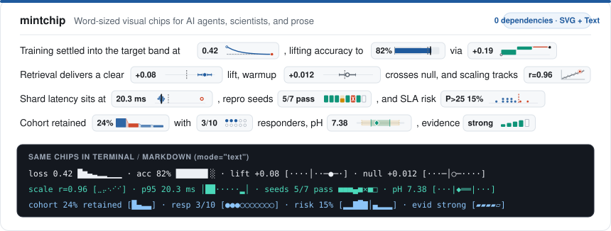
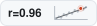
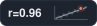
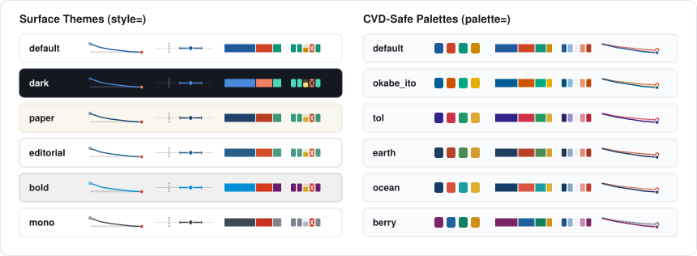

# mintchip Visual Gallery

Every component, surface theme, and color palette in `mintchip`, generated deterministically from [`build_gallery.py`](build_gallery.py) with **zero external dependencies**.

> **Interactive Browser Gallery & Triage Workbench:** Open [`output/index.html`](output/index.html) locally in any browser to switch live between **SVG / Unicode / ASCII**, toggle all **6 surface themes**, read live prose paragraphs, and mark **Keep / Refine / Drop** verdicts.



---

## Core Primitives

### `mc.spark` — Word-sized trend & target band

| Light (`style="default"`) | Dark (`style="dark"`) | Unicode (`mode="text"`) |
| :---: | :---: | :--- |
|  |  | `0.42 █▆▄▃▂▂▁▁▁` |

```python
mc.spark([1.84, 1.32, 0.96, 0.74, 0.61, 0.52, 0.46, 0.43, 0.42], band=(0.38, 0.48), reference=0.45)
```

### `mc.ci` — Uncertainty whisker vs. reference (solid = clears null, hollow = crosses null)

| Light (`style="default"`) | Dark (`style="dark"`) | Unicode (`mode="text"`) |
| :---: | :---: | :--- |
|  |  | `+0.08 [+0.05, +0.11] [··│··──●──·]` |

```python
dom = mc.shared_domain((0.05, 0.11), (-0.024, 0.048), reference=0.0)
mc.ci(0.08, (0.05, 0.11), inner_error=(0.07, 0.09), error_label="95% CI, 5 seeds", domain=dom)
```

### `mc.dist` — Mini-beeswarm dot-strip with IQR pill, median tick & outlier rings

| Light (`style="default"`) | Dark (`style="dark"`) | Unicode (`mode="text"`) |
| :---: | :---: | :--- |
|  |  | `med 20.3 ms (IQR 1.65) │██·····▂│` |

```python
mc.dist([18.2, 19.1, 19.4, 19.8, 20.0, 20.3, 20.6, 21.1, 21.4, 22.0, 47.8], unit="ms", reference=25.0)
```

### `mc.bar` — Zero-based Tufte bullet bar with qualitative bands, baseline & target

| Light (`style="default"`) | Dark (`style="dark"`) | Unicode (`mode="text"`) |
| :---: | :---: | :--- |
|  |  | `82% ██████▌░` |

```python
mc.bar(0.82, total=1.0, baseline=0.74, target=0.80, bands=(0.60, 0.80))
```

### `mc.strip` — Redundant-encoded status strip (pass/warn/fail/skip) & numeric heat strip

| Light (`style="default"`) | Dark (`style="dark"`) | Unicode (`mode="text"`) |
| :---: | :---: | :--- |
|  |  | `5/7 pass ■■■▄■×■□` |

```python
mc.strip([True, True, True, "warn", True, False, True, "skip"], labels=[f"seed_{i}" for i in range(8)])
```

---

## Change, Attribution & Tradeoffs

### `mc.delta` — Paired before → after directional arrow on shared domain

| Light (`style="default"`) | Dark (`style="dark"`) | Unicode (`mode="text"`) |
| :---: | :---: | :--- |
|  |  | `0.74→0.82 (+0.08) [····○─▶●···]` |

```python
mc.delta(0.74, 0.82, domain=(0.65, 0.88), label="Accuracy")
```

### `mc.waterfall` — Micro-attribution bridge from start to net total

| Light (`style="default"`) | Dark (`style="dark"`) | Unicode (`mode="text"`) |
| :---: | :---: | :--- |
|  |  | `0.63→0.82 (+0.19) [▲█▲▅▼▂]` |

```python
mc.waterfall({"Fine-tuning": 0.13, "Retrieval": 0.08, "Int4 quant": -0.02}, start=0.63)
```

### `mc.scatter` — 2D correlation & Pareto glyph (with 10×4 Braille scatter in plain text!)

| Light (`style="default"`) | Dark (`style="dark"`) | Unicode (`mode="text"`) |
| :---: | :---: | :--- |
|  |  | `r=0.96 [⣀⡤⠢⠊⠊]` |

```python
mc.scatter(compute, score, highlight=9, fit=True, x_label="Compute", y_label="Score")
```

---

## Composition, Funnels & Natural Frequencies

### `mc.share` — 100% stacked proportion bar (never a pie)

| Light (`style="default"`) | Dark (`style="dark"`) | Unicode (`mode="text"`) |
| :---: | :---: | :--- |
|  |  | `62/28/10% [██████▓▓▓░]` |

```python
mc.share({"Weights": 62, "KV cache": 28, "Activations": 10}, unit="GB")
```

### `mc.funnel` — Sequential pipeline / cohort attrition cascade (highlights steepest drop)

| Light (`style="default"`) | Dark (`style="dark"`) | Unicode (`mode="text"`) |
| :---: | :---: | :--- |
|  |  | `1,200→290 (24%) [█▄▃▃]` |

```python
mc.funnel({"Screened": 1200, "Eligible": 520, "Enrolled": 350, "Completed": 290})
```

### `mc.ratio` — Natural-frequency countable icon array

| Light (`style="default"`) | Dark (`style="dark"`) | Unicode (`mode="text"`) |
| :---: | :---: | :--- |
|  |  | `3/10 (30%) [●●●○○○○○○○]` |

```python
mc.ratio(3, 10)  # or mc.ratio(0.24, units=20)
```

---

## Operating Windows, Quantiles & Evidence

### `mc.gauge` — Reading inside normal and caution limits

| Light (`style="default"`) | Dark (`style="dark"`) | Unicode (`mode="text"`) |
| :---: | :---: | :--- |
|  |  | `7.38 [7.35–7.45] [···\|◆══\|···]` |

```python
mc.gauge(7.38, normal=(7.35, 7.45), warn=(7.30, 7.50), label="Blood pH")
```

### `mc.quantiles` — Micro quantile dotplot with threshold exceedance probability

| Light (`style="default"`) | Dark (`style="dark"`) | Unicode (`mode="text"`) |
| :---: | :---: | :--- |
|  |  | `P>25 ms 15% [▂▂▇█▇│▄▂▂▂]` |

```python
mc.quantiles(samples, threshold=25.0, n_dots=10, unit="ms")
```

### `mc.evidence` — Calibrated statistical strength & sample-size meter

| Light (`style="default"`) | Dark (`style="dark"`) | Unicode (`mode="text"`) |
| :---: | :---: | :--- |
|  |  | `strong (p=0.002, n=48) [▰▰▰▰▱]` |

```python
mc.evidence(p=0.002, n=48)  # or mc.evidence(bf=42, n=30)
```

---

## Structure, Timelines & Comparisons

### `mc.timeline` — Micro-Gantt & phase bottleneck strip (sequential or parallel lanes)

| Light (`style="default"`) | Dark (`style="dark"`) | Unicode (`mode="text"`) |
| :---: | :---: | :--- |
|  |  | `7.5 s (solve 64%) [▓▓██████▒▒]` |

```python
mc.timeline({"fetch": 1.2, "solve": 4.8, "verify": 1.5}, unit="s")
```

### `mc.rank` — Cohort percentile & leaderboard position ruler

| Light (`style="default"`) | Dark (`style="dark"`) | Unicode (`mode="text"`) |
| :---: | :---: | :--- |
|  |  | `#2/18 (p94) [········●·]` |

```python
mc.rank(2, 18, label="MMLU-Pro")  # or mc.rank(values=scores, value=0.89)
```

### `mc.dual_spark` — Dual trajectory & shaded divergence sparkline

| Light (`style="default"`) | Dark (`style="dark"`) | Unicode (`mode="text"`) |
| :---: | :---: | :--- |
|  |  | `0.42 vs 0.61 (Δ−0.19) [▂▃▄▅▇▇█]` |

```python
mc.dual_spark(train_loss, val_loss, labels=("train", "val"))
```

---

## Themes & Palettes



*Generator: [`build_gallery.py`](build_gallery.py)*
