# mintchip gallery

Every chip at its real size: in a sentence, in a table column beside its siblings on one
scale, as Unicode and ASCII text, with the command that makes it and its edge cases. Everything
here is generated by [`build_gallery.py`](build_gallery.py) from real `mintchip` calls.

- [`output/index.html`](output/index.html): this page as HTML, with live chips (click one for
  its details), in your light or dark theme.
- [`output/baseline.html`](output/baseline.html): every chip in a 15 px sentence on light and
  dark panels, for judging them at 1×.

The README opens with [an experiment summary](../README.md); two more before/after pairs follow.

## Before and after

<!-- BEGIN mintchip:pairs -->
### A test run

**Before**: the report as an agent usually writes it.

```text
I ran the full test suite on the branch: 412 of 418 tests passed, 4 failed and 2
were skipped. All four failures are in the io module (test_parse_dates,
test_tz_roundtrip, test_csv_quoting, test_unicode_names). The last 12 CI runs on
main went pass, pass, pass, pass, fail, pass, pass, pass, pass, pass, fail,
fail, so the breakage started two runs ago. Coverage went from 81.2% to 83.4%.
By module: io ran 96 tests in 22.4 s and failed 4, and was red in 3 of its last
8 runs; parse ran 140 tests in 14.1 s, all passing; api ran 118 in 9.8 s, all
passing, but failed once in its last 8 runs; cli ran 64 in 6.2 s with 2 skipped.
```

**After**: the same report with two chips and one table, rendered as HTML (`--format html`) in your
light or dark theme,

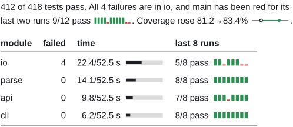

and as it prints in a terminal:

```text
412 of 418 tests pass. All 4 failures are in io, and main has been red for its
last two runs 9/12 pass (3 fail) ████×█████××. Coverage rose
81.2→83.4% (+2.2%) [··○────●··].

module  failed  time                  last 8 runs
───────────────────────────────────────────────────────
io           4  22.4/52.5 s ███▍····  5/8 pass ██×███××
parse        0  14.1/52.5 s ██▏·····  8/8 pass ████████
api          0   9.8/52.5 s █▌······  7/8 pass ███×████
cli          0   6.2/52.5 s █·······  8/8 pass ████████
```

<details><summary>The two commands that wrote it</summary>

```text
$ cat message.txt
412 of 418 tests pass. All 4 failures are in io, and main has been red for its last two runs {{strip pass pass pass pass fail pass pass pass pass pass fail fail}}. Coverage rose {{delta 81.2 83.4 unit=% higher_is_better=true}}.
$ mintchip render message.txt
412 of 418 tests pass. All 4 failures are in io, and main has been red for its last two runs 9/12 pass (3 fail) ████×█████××. Coverage rose 81.2→83.4% (+2.2%) [··○────●··].

$ cat modules.json
[
{"module": "io", "failed": 4, "time": 22.4, "runs": ["pass", "pass", "fail", "pass", "pass", "pass", "fail", "fail"]},
{"module": "parse", "failed": 0, "time": 14.1, "runs": ["pass", "pass", "pass", "pass", "pass", "pass", "pass", "pass"]},
{"module": "api", "failed": 0, "time": 9.8, "runs": ["pass", "pass", "pass", "fail", "pass", "pass", "pass", "pass"]},
{"module": "cli", "failed": 0, "time": 6.2, "runs": ["pass", "pass", "pass", "pass", "pass", "pass", "pass", "pass"]}
]
$ mintchip table modules.json --col module --col failed:num --col time:bar:time --col 'runs:strip:last 8 runs' \
    --set time.total=52.5 --set time.unit=s
module  failed  time                  last 8 runs
───────────────────────────────────────────────────────
io           4  22.4/52.5 s ███▍····  5/8 pass ██×███××
parse        0  14.1/52.5 s ██▏·····  8/8 pass ████████
api          0   9.8/52.5 s █▌······  7/8 pass ███×████
cli          0   6.2/52.5 s █·······  8/8 pass ████████
```

</details>

### A benchmark comparison

**Before**: the report as an agent usually writes it.

```text
I benchmarked the new parser against main on five inputs, 18 runs each.
small.json went from 1.92 ms to 1.41 ms (−27%, 95% CI −30% to −24%), medium.json
from 18.4 ms to 12.9 ms (−30%, −33% to −27%), large.json from 212 ms to 151 ms
(−29%, −31% to −27%), nested.json from 44.0 ms to 46.1 ms (+5%, +2% to +8%, a
regression) and unicode.json from 31.2 ms to 22.8 ms (−27%, −30% to −24%). On
large.json the median run took 151 ms with an interquartile range of 149 to 153
ms, but one run took 240 ms. Peak memory fell from 84 MB to 61 MB.
```

**After**: the same report with two chips and one table, rendered as HTML (`--format html`) in your
light or dark theme,

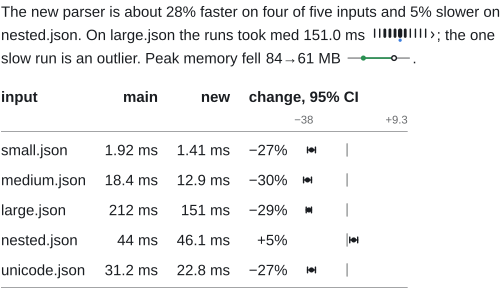

and as it prints in a terminal:

```text
The new parser is about 28% faster on four of five inputs and 5% slower on
nested.json. On large.json the runs took
med 151.0 ms (n=18, IQR 149.0 to 152.8) [▂▂▄▄▄█▂▂▂▂]→240; the one slow run is an
outlier. Peak memory fell 84→61 MB (−23 MB) [··●────○··].

input            main      new  change, 95% CI
                                     −38      +9.3
──────────────────────────────────────────────────
small.json    1.92 ms  1.41 ms  −27% [··●┤····│··]
medium.json   18.4 ms  12.9 ms  −30% [·├●·····│··]
large.json     212 ms   151 ms  −29% [··●·····│··]
nested.json     44 ms  46.1 ms   +5% [········├●┤]
unicode.json  31.2 ms  22.8 ms  −27% [··●┤····│··]
```

<details><summary>The two commands that wrote it</summary>

```text
$ cat message.txt
The new parser is about 28% faster on four of five inputs and 5% slower on nested.json. On large.json the runs took {{dist 146 147 148 148 149 149 150 150 151 151 151 152 152 153 154 155 156 240 unit=ms}}; the one slow run is an outlier. Peak memory fell {{delta 84 61 unit=MB higher_is_better=false}}.
$ mintchip render message.txt
The new parser is about 28% faster on four of five inputs and 5% slower on nested.json. On large.json the runs took med 151.0 ms (n=18, IQR 149.0 to 152.8) [▂▂▄▄▄█▂▂▂▂]→240; the one slow run is an outlier. Peak memory fell 84→61 MB (−23 MB) [··●────○··].
mintchip: warning: line 1, column 117: {{dist 146 147 148 148 149 149 150 150 151 15...}}: 1 sample(s) (240) beyond 3×IQR clipped so they do not flatten the scale; their values are printed past the brackets in text and a chevron marks the edge in SVG.

$ cat bench.json
[
{"input": "small.json", "main": 1.92, "new": 1.41, "change": [-27, -30, -24]},
{"input": "medium.json", "main": 18.4, "new": 12.9, "change": [-30, -33, -27]},
{"input": "large.json", "main": 212, "new": 151, "change": [-29, -31, -27]},
{"input": "nested.json", "main": 44.0, "new": 46.1, "change": [5, 2, 8]},
{"input": "unicode.json", "main": 31.2, "new": 22.8, "change": [-27, -30, -24]}
]
$ mintchip table bench.json --col input --col main:num:main --col new:num:new --col 'change:ci:change, 95% CI' \
    --set main.unit=ms --set new.unit=ms --set change.unit=% --set change.level=0.95
input            main      new  change, 95% CI
                                     −38      +9.3
──────────────────────────────────────────────────
small.json    1.92 ms  1.41 ms  −27% [··●┤····│··]
medium.json   18.4 ms  12.9 ms  −30% [·├●·····│··]
large.json     212 ms   151 ms  −29% [··●·····│··]
nested.json     44 ms  46.1 ms   +5% [········├●┤]
unicode.json  31.2 ms  22.8 ms  −27% [··●┤····│··]
```

</details>
<!-- END mintchip:pairs -->

## Recipes for coding agents

<!-- BEGIN mintchip:recipes -->
**Test results.** CI jobs or test files, each pass, warn, fail or skip:

```text
$ mintchip strip pass pass pass warn fail pass skip --names lint,types,unit,docs,e2e,bench,gpu
4/7 pass (1 fail, 1 warn, 1 skip) ███▄×█·
```

**Diff size.** Changed lines by area, from `git diff --numstat`:

```text
$ mintchip share src=310 tests=142 docs=48 --unit lines
62·28·9.6% ██████▏███▏█
```

**Coverage.** Against the previous run and the project's target:

```text
$ mintchip bar 0.834 --baseline 0.812 --target 0.85 --label coverage
83% (baseline 81%, target 85%) ██████▋·
```

**Benchmark before and after.** Say which direction is better, so a regression shows in red:

```text
$ mintchip delta 212 151 --unit ms --no-higher-is-better --label p50
212→151 ms (−61 ms) [··●────○··]
```

**Time per phase.** Where the seconds of a CI run went:

```text
$ mintchip timeline install=12 collect=9 test=61 report=12
94 s (test 65%) █▏█▏██████▏█
```

**Context budget.** Tokens used out of the window; past the total, the bar says so:

```text
$ mintchip bar 148000 --total 200000 --unit tokens --label context
148,000/200,000 tokens (74%) █████▉··
```
<!-- END mintchip:recipes -->

## The chips

<!-- BEGIN mintchip:chips -->
<a id="num"></a>
### `num`: What is the value?

You have: one number, no context.

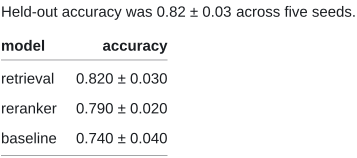

```text
$ mintchip num 0.82 --pm 0.03 --label Accuracy
0.82 ± 0.03
$ mintchip num 0.82 --pm 0.03 --label Accuracy --ascii
0.82 +/- 0.03
$ mintchip num 0.82 --pm 0.03 --label Accuracy --compact
0.82 ± 0.03
```

Edge cases:

- **Significant figures.**

  ```text
  $ mintchip num 0.0012345 --unit s --sig 2
  0.0012 s
  ```
- **A signed change.**

  ```text
  $ mintchip num 0.08 --signed
  +0.08
  ```

<a id="spark"></a>
### `spark`: How did a value evolve over steps or time?

You have: a series over time or steps.

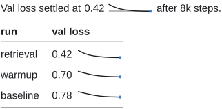

```text
$ mintchip spark 1.84 1.32 0.96 0.74 0.61 0.52 0.46 0.43 0.42 --band 0.38:0.48
0.42 (range 0.42 to 1.84) █▆▄▃▂▂▁▁▁
$ mintchip spark 1.84 1.32 0.96 0.74 0.61 0.52 0.46 0.43 0.42 --band 0.38:0.48 --ascii
0.42 (range 0.42 to 1.84) #+~-..___
$ mintchip spark 1.84 1.32 0.96 0.74 0.61 0.52 0.46 0.43 0.42 --band 0.38:0.48 --compact
0.42 █▆▄▃▂▂▁▁▁
```

Edge cases:

- **Two series.** 

  ```text
  $ mintchip spark 1.84 1.32 0.96 0.74 0.61 0.52 0.46 0.43 0.42 --vs 1.85 1.6 1.36 1.15 0.99 0.89 0.83 0.8 0.78
  0.42 vs 0.78 █▅▄▃▂▁▁▁▁ █▇▆▅▄▃▃▃▃
  ```
- **A range under 2 % of the level.** 

  ```text
  $ mintchip spark 0.4200 0.4201 0.4203 0.4206 0.4204 0.4206
  0.4206 (range 0.4200 to 0.4206) ▁▂▅█▆█ ±0.071%
  mintchip: warning: the series spans only ±0.071% of its level, stretched to full height (marked ±0.071% in text, an axis break in SVG).
  ```
- **A spike in 40 points.** 

  ```text
  $ mintchip spark 1 1 1 1 1 1 1 1 1 1 1 1 1 1 1 1 1 50 1 1 1 1 1 1 1 1 1 1 1 1 1 1 1 1 1 1 1 1 1 1
  1 (range 1 to 50) ▁▁▁▁▁█▁▁▁▁▁▁ n=40
  mintchip: warning: text shows 40 points in 12 cells, keeping each cell's most extreme value (marked n=40).
  ```
- **A domain that cuts the data.** 

  ```text
  $ mintchip spark 1.84 1.32 0.96 0.74 0.61 --domain 0.5:1.5
  0.61 (range 0.61 to 1.84) ^▇▄▃▂
  mintchip: warning: domain 0.5 to 1.5 cuts 1 value(s); they are pinned to the edge and marked (^ or v in text, a chevron in SVG).
  ```

<a id="ci"></a>
### `ci`: What is the estimate, and how sure are we?

You have: an estimate with an interval.

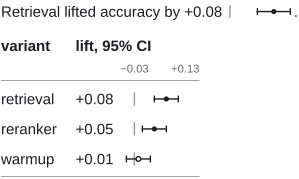

```text
$ mintchip ci 0.08 0.05:0.11 --level 0.95 --label 'Retrieval lift'
+0.08 (95% CI +0.05 to +0.11) [·│···├─●─┤·]
$ mintchip ci 0.08 0.05:0.11 --level 0.95 --label 'Retrieval lift' --ascii
+0.08 (95% CI +0.05 to +0.11) [.|...(-*-).]
$ mintchip ci 0.08 0.05:0.11 --level 0.95 --label 'Retrieval lift' --compact
+0.08 [·│···├─●─┤·]
```

Edge cases:

- **The interval crosses the reference.** 

  ```text
  $ mintchip ci 0.01 -0.02:0.04 --level 0.95
  +0.01 (95% CI −0.02 to +0.04) [·├──┼○───┤·]
  ```
- **No level stated.** 

  ```text
  $ mintchip ci 0.08 0.05:0.11
  +0.08 (+0.05 to +0.11) [·│···├─●─┤·]
  mintchip: warning: interval level not stated; state the interval's level (level=0.95) or its true coverage.
  ```
- **A domain that cuts the interval.** 

  ```text
  $ mintchip ci 0.08 0.05:0.11 --level 0.95 --domain 0:0.1
  +0.08 (95% CI +0.05 to +0.11) [│····├──●──>
  mintchip: warning: domain 0 to 0.1 cuts the interval; the cut end is marked at the edge (< or > in text, a chevron in SVG).
  ```

<a id="dist"></a>
### `dist`: How are the samples spread, and are there outliers?

You have: raw samples of one measurement.

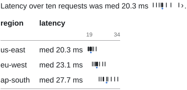

```text
$ mintchip dist 18.9 19.4 19.8 20.1 20.3 20.3 20.9 21.6 22.8 47.8 --label 'Request latency' \
    --unit ms
med 20.3 ms (n=10, IQR 19.9 to 21.4) [▃▃▃█·▃▃··▃]→47.8
mintchip: warning: 1 sample(s) (47.8) beyond 3×IQR clipped so they do not flatten the scale; their values are printed past the brackets in text and a chevron marks the edge in SVG.
$ mintchip dist 18.9 19.4 19.8 20.1 20.3 20.3 20.9 21.6 22.8 47.8 --label 'Request latency' \
    --unit ms --ascii
med 20.3 ms (n=10, IQR 19.9 to 21.4) [---#.--..-]->47.8
mintchip: warning: 1 sample(s) (47.8) beyond 3×IQR clipped so they do not flatten the scale; their values are printed past the brackets in text and a chevron marks the edge in SVG.
$ mintchip dist 18.9 19.4 19.8 20.1 20.3 20.3 20.9 21.6 22.8 47.8 --label 'Request latency' \
    --unit ms --compact
med 20.3 ms [▃▃▃█·▃▃··▃]→47.8
mintchip: warning: 1 sample(s) (47.8) beyond 3×IQR clipped so they do not flatten the scale; their values are printed past the brackets in text and a chevron marks the edge in SVG.
```

Edge cases:

- **An outlier beyond 3×IQR.** 

  ```text
  $ mintchip dist 18.9 19.4 19.8 20.1 20.3 20.3 20.9 21.6 22.8 47.8 --unit ms
  med 20.3 ms (n=10, IQR 19.9 to 21.4) [▃▃▃█·▃▃··▃]→47.8
  mintchip: warning: 1 sample(s) (47.8) beyond 3×IQR clipped so they do not flatten the scale; their values are printed past the brackets in text and a chevron marks the edge in SVG.
  ```
- **A threshold.** 

  ```text
  $ mintchip dist 18.9 19.4 19.8 20.1 20.3 20.3 20.9 21.6 22.8 25.7 --unit ms --threshold 21
  P>21 ms 30% (3 of 10) [▃▆█│▃▃▃···▃]
  ```
- **Missing samples.** 

  ```text
  $ mintchip dist 18.9 null 19.8 20.1 nan 20.3 20.9 --unit ms
  med 20.1 ms (n=5, IQR 19.8 to 20.3) [█···███··█]
  mintchip: warning: 2 missing sample(s) skipped; n=5 counts the rest.
  ```
- **Three samples.** 

  ```text
  $ mintchip dist 20.1 20.4 22.9 --unit ms
  med 20.40 ms (n=3, IQR 20.25 to 21.65) [██·······█]
  ```
- **All samples equal.** 

  ```text
  $ mintchip dist 20 20 20 20 20 20 20 20 20 20 --unit ms
  med 20 ms (n=10, IQR 20 to 20) [·····█····]
  ```

<a id="bar"></a>
### `bar`: How much of a total, budget or capacity is used?

You have: a value against a total.

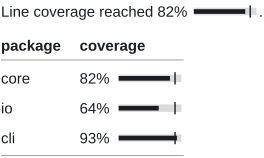

```text
$ mintchip bar 0.82 --target 0.9 --label 'Test coverage'
82% (target 90%) ██████▌│
$ mintchip bar 0.82 --target 0.9 --label 'Test coverage' --ascii
82% (target 90%) #######|
$ mintchip bar 0.82 --target 0.9 --label 'Test coverage' --compact
82% ██████▌│
```

Edge cases:

- **Over the total.** 

  ```text
  $ mintchip bar 1.12
  112% ████████+
  mintchip: warning: value 112% exceeds the total; the bar fills the track and is marked + in text and by a chevron in SVG.
  ```
- **Against a baseline.** 

  ```text
  $ mintchip bar 0.834 --baseline 0.812 --target 0.85
  83% (baseline 81%, target 85%) ██████▋·
  ```

<a id="gauge"></a>
### `gauge`: Is a reading inside its normal range?

You have: a reading with a normal range.

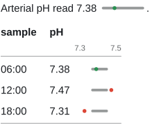

```text
$ mintchip gauge 7.38 7.35:7.45 --label 'Blood pH'
7.38 (normal 7.35 to 7.45) [···├●───┤··]
$ mintchip gauge 7.38 7.35:7.45 --label 'Blood pH' --ascii
7.38 (normal 7.35 to 7.45) [...(*---)..]
$ mintchip gauge 7.38 7.35:7.45 --label 'Blood pH' --compact
7.38 [···├●───┤··]
```

Edge cases:

- **Above the normal range.** 

  ```text
  $ mintchip gauge 7.5 7.35:7.45
  7.50 (high; normal 7.35 to 7.45) [··├───┤·●··]
  ```
- **A domain that cuts the reading.** 

  ```text
  $ mintchip gauge 7.6 7.35:7.45 --domain 7.3:7.5
  7.60 (high; normal 7.35 to 7.45) [··├─────┤·●>
  mintchip: warning: domain 7.3 to 7.5 cuts the reading or its ranges; a cut reading is pinned to the edge and marked (< or > in text, a chevron in SVG).
  ```

<a id="delta"></a>
### `delta`: How much did a value change from before to after?

You have: a before and an after value.

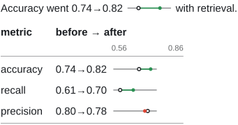

```text
$ mintchip delta 0.74 0.82 --higher-is-better --label Accuracy
0.74→0.82 (+0.08) [··○────●··]
$ mintchip delta 0.74 0.82 --higher-is-better --label Accuracy --ascii
0.74->0.82 (+0.08) [..o----*..]
$ mintchip delta 0.74 0.82 --higher-is-better --label Accuracy --compact
0.74→0.82 [··○────●··]
```

Edge cases:

- **A change for the worse.** 

  ```text
  $ mintchip delta 0.80 0.78 --higher-is-better
  0.80→0.78 (−0.02) [··●────○··]
  ```
- **Lower is better.** 

  ```text
  $ mintchip delta 212 151 --unit ms --no-higher-is-better
  212→151 ms (−61 ms) [··●────○··]
  ```
- **No direction stated.** 

  ```text
  $ mintchip delta 0.74 0.82
  0.74→0.82 (+0.08) [··○────●··]
  ```
- **A domain that cuts the change.** 

  ```text
  $ mintchip delta 0.74 0.82 --domain 0.7:0.8
  0.74→0.82 (+0.08) [····○────●>
  mintchip: warning: domain 0.7 to 0.8 cuts the change; the cut end is pinned to the edge and marked (< or > in text, a chevron in SVG).
  ```

<a id="strip"></a>
### `strip`: Which items passed, warned, failed or were skipped?

You have: a pass/warn/fail/skip result per item.

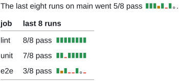

```text
$ mintchip strip true true true warn true false true null --label Suites
5/8 pass (1 fail, 1 warn, 1 skip) ███▄█×█·
$ mintchip strip true true true warn true false true null --label Suites --ascii
5/8 pass (1 fail, 1 warn, 1 skip) ###~#x#.
$ mintchip strip true true true warn true false true null --label Suites --compact
5/8 pass ███▄█×█·
```

Edge cases:

- **More items than cells.** 

  ```text
  $ mintchip strip pass pass pass pass pass pass pass pass pass pass pass pass pass fail pass pass pass pass pass pass pass pass pass warn pass pass pass pass pass pass
  28/30 pass (1 fail, 1 warn) █████████×█████▄████ n=30
  mintchip: warning: 30 items shown in 20 cells, each the worst state of its bucket (marked n=30).
  ```
- **Named items.** 

  ```text
  $ mintchip strip pass fail pass --names lint,unit,e2e
  2/3 pass (1 fail) █×█
  ```

<a id="share"></a>
### `share`: How is a whole split into parts?

You have: parts of a whole.

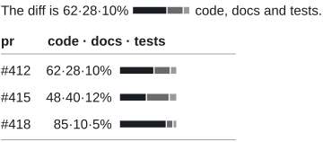

```text
$ mintchip share code=62 docs=28 tests=10 --label 'Changed lines'
62·28·10% ██████▏███▏█
$ mintchip share code=62 docs=28 tests=10 --label 'Changed lines' --ascii
62/28/10% ######|###|#
$ mintchip share code=62 docs=28 tests=10 --label 'Changed lines' --compact
62·28·10% ██████▏███▏█
```

Edge cases:

- **A part under one cell.** 

  ```text
  $ mintchip share code=97 docs=2.5 tests=0.5
  97·2.5·0.5% ████████▏▄▏▄
  mintchip: warning: docs (2.5%) is under one text cell of 10; it is drawn as one half-height cell (▄) taken from the largest part.
  mintchip: warning: tests (0.5%) is under one text cell of 10; it is drawn as one half-height cell (▄) taken from the largest part.
  ```
- **More parts than segments.** 

  ```text
  $ mintchip share a=30 b=20 c=15 d=10 e=8 f=7 g=5 h=5
  30·20·15·35% ███▏██▏█▏███ other=5
  mintchip: warning: 5 parts beyond the largest 3 are folded into one 'other' segment (35%), drawn last (marked other=5).
  ```
- **In the given order.** 

  ```text
  $ mintchip share tests=10 docs=28 code=62 --no-sort
  10·28·62% █▏███▏██████
  ```

<a id="ratio"></a>
### `ratio`: How many out of how many?

You have: a count out of a total, or a probability.

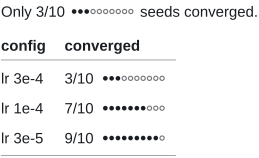

```text
$ mintchip ratio 3 10 --label 'Runs that diverged'
3/10 ●●●○○○○○○○
$ mintchip ratio 3 10 --label 'Runs that diverged' --ascii
3/10 ***ooooooo
$ mintchip ratio 3 10 --label 'Runs that diverged' --compact
3/10 ●●●○○○○○○○
```

Edge cases:

- **A ratio that does not round to whole icons.** 

  ```text
  $ mintchip ratio 412 418
  412/418 ●●●●●●●●●·
  mintchip: warning: 99% is 9.86 of 10 icons; rounding to 10 would misstate it, so the boundary icon is drawn as a partial icon (· in text, a small dot in SVG).
  ```
- **A small total.** 

  ```text
  $ mintchip ratio 1 3
  1/3 ●○○
  ```

<a id="timeline"></a>
### `timeline`: Where did the time go?

You have: durations of phases.

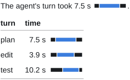

```text
$ mintchip timeline fetch=1.2 solve=4.8 write=1.5 --label 'Agent step'
7.5 s (solve 64%) ██▏██████▏██
$ mintchip timeline fetch=1.2 solve=4.8 write=1.5 --label 'Agent step' --ascii
7.5 s (solve 64%) ##|######|##
$ mintchip timeline fetch=1.2 solve=4.8 write=1.5 --label 'Agent step' --compact
7.5 s ██▏██████▏██
```

Edge cases:

- **A phase under one cell.** 

  ```text
  $ mintchip timeline fetch=0.1 solve=6.8 write=0.6
  7.5 s (solve 91%) ▄▏████████▏█
  mintchip: warning: phase 'fetch' (0.1 s, 1.3%) is under one text cell of 10; it is drawn as one half-height cell (▄), and as a half-height bar in SVG if it is narrower than the minimum.
  ```
- **Overlapping phases.** 

  ```text
  $ mintchip timeline fetch=0:1.2 solve=1:6 write=5.5:7
  7 s (solve 71%) █▏███████▏██ overlap 0.7 s
  mintchip: warning: phases overlap for 0.7 s (up to 2 at once); the SVG stacks them in 2 lanes, the one-line text lets the later phase cover the overlap (marked overlap 0.7 s).
  ```

<a id="rank"></a>
### `rank`: Where does one item stand in its field?

You have: a position in a ranked field.


```text
$ mintchip rank 2 18 --label Leaderboard
#2/18 [········●·]
$ mintchip rank 2 18 --label Leaderboard --ascii
#2/18 [........*.]
$ mintchip rank 2 18 --label Leaderboard --compact
#2/18 [········●·]
```

Edge cases:

- **Ranked among values.** 

  ```text
  $ mintchip rank --values 0.72 0.81 0.88 0.79 --value 0.85
  #2/5 (0.85) [·······●··]
  mintchip: warning: value 0.85 is not in values; ranked as an extra entry (field of 5).
  ```

<a id="waterfall"></a>
### `waterfall`: Which contributions took a value from its start to its total?

You have: signed contributions from a start to a total.

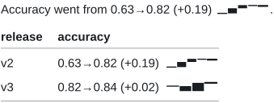

```text
$ mintchip waterfall retrieval=0.13 reranker=0.08 'latency cap=-0.02' --start 0.63 \
    --label Accuracy
0.63 +0.13 +0.08 −0.02 = 0.82
$ mintchip waterfall retrieval=0.13 reranker=0.08 'latency cap=-0.02' --start 0.63 \
    --label Accuracy --ascii
0.63 +0.13 +0.08 -0.02 = 0.82
$ mintchip waterfall retrieval=0.13 reranker=0.08 'latency cap=-0.02' --start 0.63 \
    --label Accuracy --compact
0.63→0.82 (+0.19)
```

Edge cases:

- **More steps than terms.** 

  ```text
  $ mintchip waterfall a=0.05 b=0.04 c=-0.03 d=0.02 e=0.02 f=-0.01 g=0.01 --start 0.6
  0.60 +0.05 +0.04 −0.03 +0.04 (4 others) = 0.70
  mintchip: warning: text shows the 3 largest of 7 steps and sums the other 4 into one term (+0.04 (4 others)).
  ```

<a id="funnel"></a>
### `funnel`: How many make it through each stage?

You have: counts through ordered stages.


```text
$ mintchip funnel visited=1200 'signed up=520' activated=350 retained=290
1,200 → 520 → 350 → 290 (24%)
$ mintchip funnel visited=1200 'signed up=520' activated=350 retained=290 --ascii
1,200 -> 520 -> 350 -> 290 (24%)
$ mintchip funnel visited=1200 'signed up=520' activated=350 retained=290 --compact
1,200 → 290 (24%)
```

Edge cases:

- **A stage larger than the one before.** 

  ```text
  $ mintchip funnel visited=1200 signed=520 activated=560
  1,200 → 520 → 560! (47%)
  mintchip: warning: stage 'activated' (560) is larger than 'signed' (520); marked ! in text and outlined in SVG.
  ```
<!-- END mintchip:chips -->
